<p align="center">
  
</p>

<h1 align="center">RoadVet</h1>

<p align="center">
  Aplicativo móvel <b>offline-first</b> para médicos veterinários que fazem atendimento domiciliar em regiões com pouca ou nenhuma conexão à internet.
</p>

<p align="center">
  
  
  
  
  
</p>

## Sobre o projeto

**Este repositório faz parte de um Trabalho de Conclusão de Curso (TCC)** do curso de Ciência da Computação da Universidade de Fortaleza (UNIFOR), intitulado:

**"Arquitetura de Sistemas Offline-First como Amparo à Prática Veterinária em Regiões de Baixa Conectividade"**

| | |
|---|---|
| **Autores** | João Felipe Ribeiro de Melo e João Pedro Ribeiro Mendes |
| **Orientador** | Prof. Belmondo Rodrigues Aragão Júnior |
| **Instituição** | Universidade de Fortaleza (UNIFOR) |
| **Ano** | 2026 |

O RoadVet permite que o veterinário cadastre **tutores**, **pets** e **prontuários clínicos** direto no celular, mesmo sem internet. Os dados ficam salvos no dispositivo e são sincronizados com o servidor automaticamente assim que a conexão volta. Isso evita a perda de informações e mantém o atendimento ágil em áreas remotas.

Por ser um projeto acadêmico, o foco está em demonstrar a arquitetura offline-first e o mecanismo de sincronização. Não se trata de um produto comercial.

## Repositórios relacionados

| Repositório | Conteúdo |
|---|---|
| [**roadvet-frontend**](https://github.com/Magoninho/roadvet-frontend) (este) | Aplicativo móvel em React Native + Expo |
| [**RoadVet-BackEnd**](https://github.com/jpmendesdev/RoadVet-BackEnd) | API em Django REST Framework que recebe e devolve as alterações na sincronização |
| [**roadvet-artigo**](https://github.com/Magoninho/roadvet-artigo) | Texto do TCC em LaTeX (modelo UniforTeX2 / abnTeX2) |

## Telas do aplicativo

As capturas abaixo foram retiradas do [texto do TCC](https://github.com/Magoninho/roadvet-artigo).

### Acesso

| Boas-vindas | Cadastro | Login |
|:---:|:---:|:---:|
| 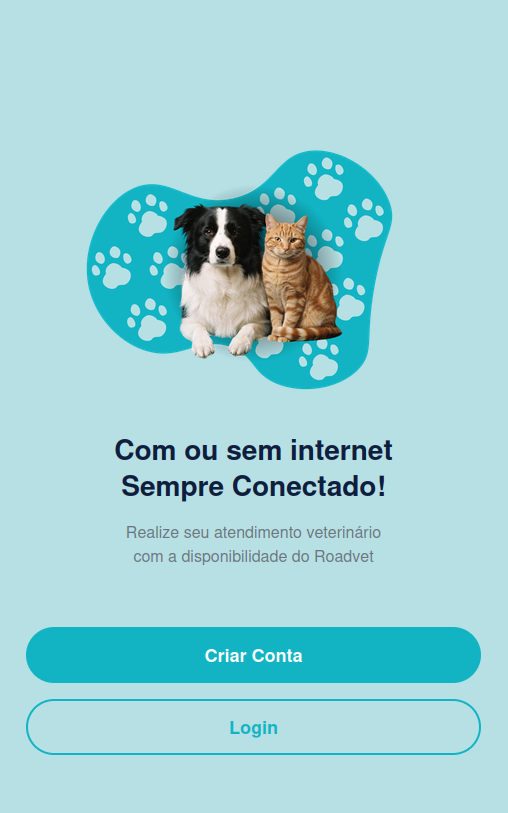 | 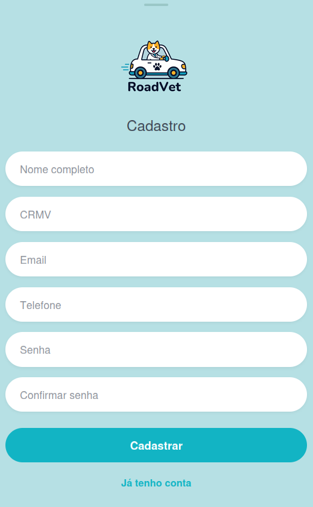 | 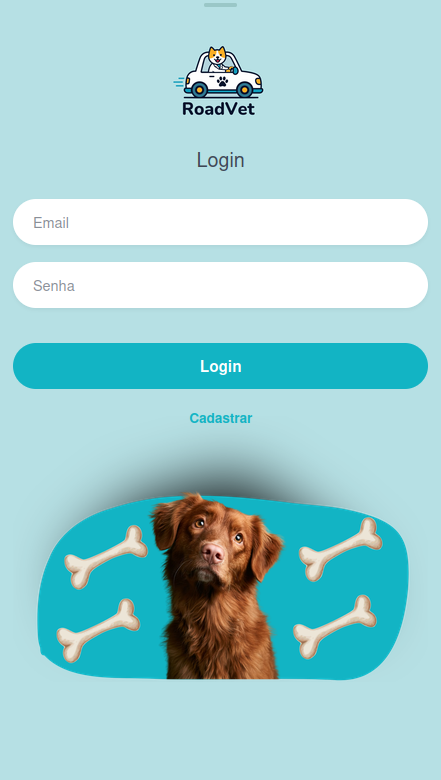 |

### Painel e prontuários

| Painel principal | Lista de prontuários | Seleção do paciente |
|:---:|:---:|:---:|
| 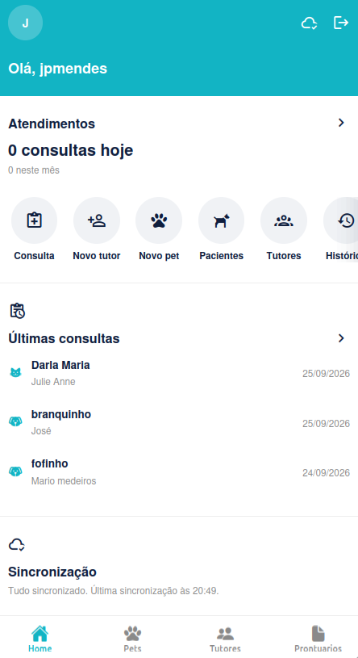 | 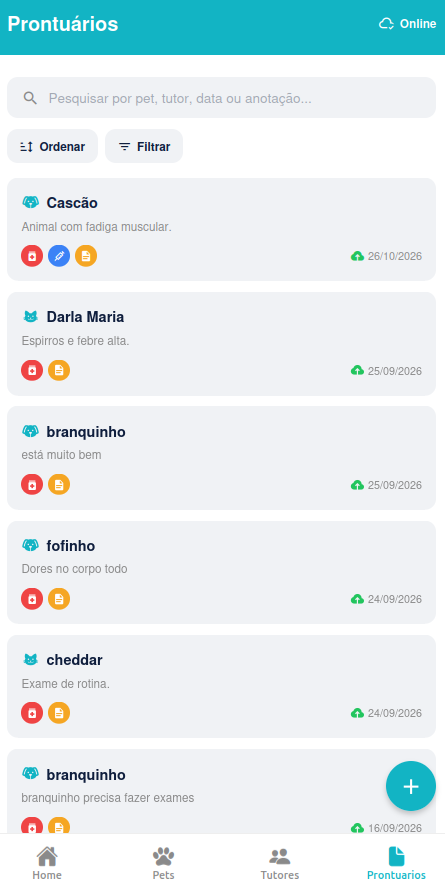 | 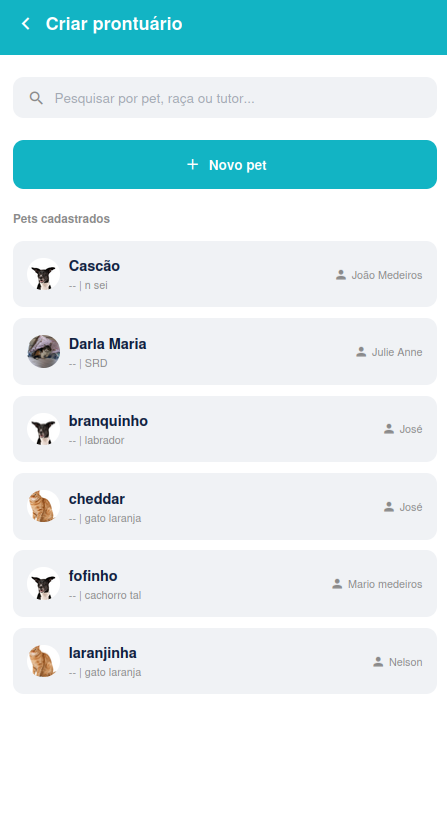 |

| Formulário do prontuário (parte 1) | Formulário do prontuário (parte 2) |
|:---:|:---:|
| 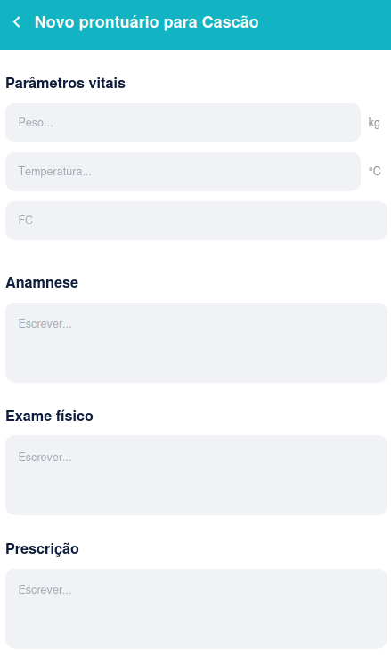 | 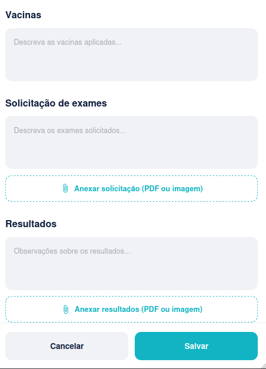 |

### Cadastro de pets e tutores

| Novo pet | Novo tutor |
|:---:|:---:|
| 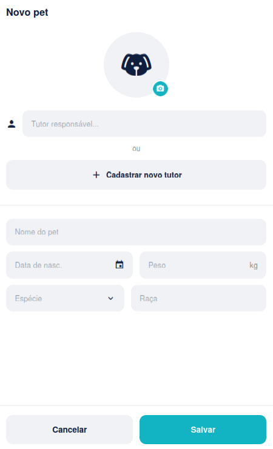 | 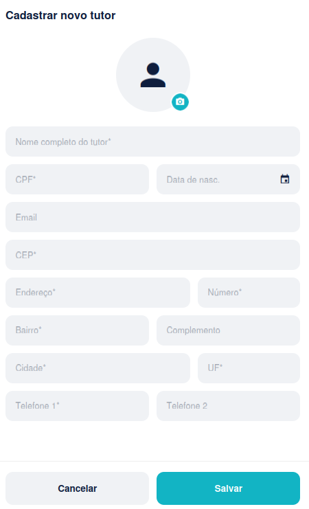 |

### Sincronização

<p align="center">
  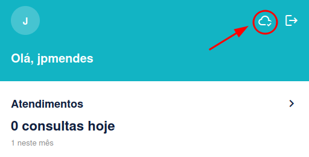
</p>

## Funcionalidades

- Cadastro e login do veterinário, com autenticação JWT.
- Cadastro, edição e exclusão de **tutores**, **pets** e **prontuários**.
- Prontuário com peso, temperatura, frequência cardíaca, anamnese, exame físico, prescrição, vacinas, exames e anexos de arquivos.
- Foto de perfil para veterinário, tutores e pets.
- Busca, filtros e ordenação nas listas.
- Funcionamento completo **sem internet**.
- Sincronização automática em segundo plano, com indicador de estado na tela inicial.

## Arquitetura

<p align="center">
  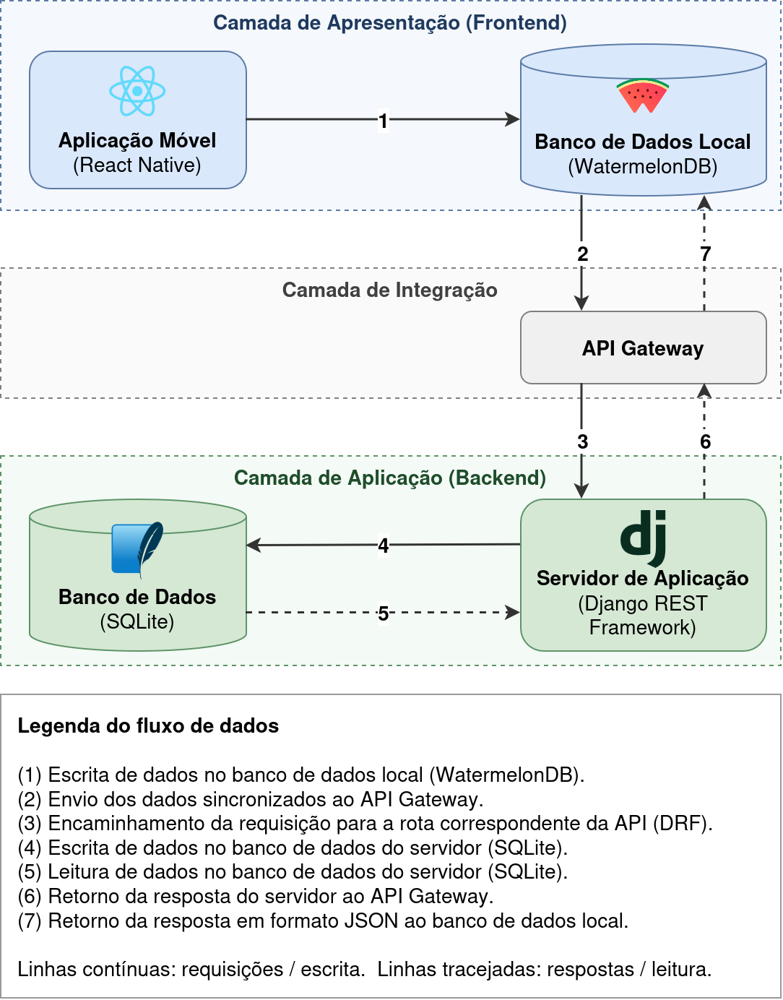
</p>

O sistema segue o modelo **cliente-servidor** com uma API REST, combinado ao paradigma **offline-first**:

1. **Toda operação acontece primeiro no aparelho.** Criar, editar e excluir registros grava apenas no banco local ([WatermelonDB](https://watermelondb.dev), sobre SQLite), com ou sem conexão.
2. **Cada registro guarda seu estado de sincronização.** O WatermelonDB marca o que foi criado, alterado ou excluído desde a última sincronização. Exclusões ficam apenas marcadas até o servidor confirmar.
3. **A sincronização usa uma rota única da API** (`/api/sync`), em duas etapas:
   - **pull**: o app busca o que mudou no servidor desde a última sincronização;
   - **push**: o app envia, em um único lote, tudo o que está pendente no aparelho.
4. **Quando ela acontece:** ao abrir o app, ao voltar do segundo plano, quando a rede retorna e periodicamente enquanto houver conexão. Se falhar, tenta de novo automaticamente.
5. **Conflitos** são resolvidos pela estratégia **Last-Write-Wins** (a última escrita prevalece). No pull, campos alterados no aparelho e ainda não enviados são preservados.
6. **Arquivos** (anexos e fotos) são enviados em uma etapa separada, depois que os metadados do registro já foram sincronizados.

O lado do servidor (validação do lote, transação única e exclusão lógica) está documentado no [RoadVet-BackEnd](https://github.com/jpmendesdev/RoadVet-BackEnd).

## Tecnologias

| Camada | Tecnologia |
|---|---|
| Framework | [Expo](https://docs.expo.dev/versions/v57.0.0/) SDK 57, React Native 0.86, React 19 |
| Navegação | Expo Router (rotas por arquivo, rotas tipadas) |
| Banco local | WatermelonDB 0.28 (SQLite no Android/iOS, LokiJS na web) |
| Rede | Fetch + `@react-native-community/netinfo` para detectar a conexão |
| Armazenamento seguro | `expo-secure-store` para os tokens JWT |
| Linguagem | TypeScript |
| Backend | Django REST Framework + SQLite ([repositório](https://github.com/jpmendesdev/RoadVet-BackEnd)) |

## Estrutura de pastas

```
src/
  app/                 Telas (Expo Router)
    (auth)/            Boas-vindas, login, cadastro e termos
    (tabs)/            Abas: Home, Pets, Tutores e Prontuários
    (modals)/          Detalhes e formulários de pets, tutores, prontuários e perfil
    components/        Componentes reutilizáveis de interface
  contexts/            Contexto de autenticação
  database/
    models/            Modelos do WatermelonDB (Veterinario, Tutor, Pet, Prontuario, Anexo)
    repositories/      Operações de leitura e escrita no banco local
    sync/              Motor de sincronização, conectividade e envio de arquivos
    schema.ts          Esquema do banco local
    migrations.ts      Migrações do banco local
  services/            Cliente HTTP da API e armazenamento de tokens
  hooks/               Hooks de busca, filtros e confirmação de exclusão
  utils/               Formatação, validação, ordenação e afins
docs/screenshots/      Imagens usadas neste README
```

## Como executar

### Pré-requisitos

- [Node.js](https://nodejs.org) 20 ou superior
- Android Studio (emulador ou aparelho físico) para Android, ou Xcode para iOS
- O [backend do RoadVet](https://github.com/jpmendesdev/RoadVet-BackEnd) rodando, para testar a sincronização

**Atenção:** o WatermelonDB usa código nativo, então o app **não roda no Expo Go**. É preciso gerar um development build com `npx expo run:android` ou `npx expo run:ios`.

### Passo a passo

1. Instale as dependências:

   ```bash
   npm install
   ```

2. Crie o arquivo `.env` a partir do exemplo e informe o endereço da API:

   ```bash
   cp .env.example .env
   ```

   | Onde o app roda | Valor de `EXPO_PUBLIC_API_URL` |
   |---|---|
   | Web ou simulador iOS | `http://localhost:8000/api` |
   | Emulador Android | `http://10.0.2.2:8000/api` |
   | Aparelho físico na mesma rede Wi-Fi | `http://<IP-do-computador>:8000/api` |

   O endereço é embutido no app no momento do build. Se mudar o valor, gere o build de novo.

3. Rode o app:

   ```bash
   npm run android   # compila e abre no Android
   npm run ios       # compila e abre no iOS (somente macOS)
   npm run web       # abre no navegador
   ```

   Depois do primeiro build, basta `npm start` para iniciar o servidor de desenvolvimento.

### Outros comandos

| Comando | O que faz |
|---|---|
| `npm start` | Inicia o servidor de desenvolvimento do Expo |
| `npm run lint` | Verifica o código com o ESLint |

## Testando o modo offline

1. Faça login com o backend ligado, para que a primeira sincronização aconteça.
2. Desligue o Wi-Fi e os dados móveis do aparelho (ou pare o backend).
3. Cadastre tutores, pets e prontuários normalmente. Tudo continua funcionando.
4. Religue a conexão. O app sincroniza sozinho e o card **Sincronização** da tela inicial mostra "Tudo sincronizado".

## Licença

Distribuído sob a licença MIT. Veja o arquivo [LICENSE](LICENSE).
